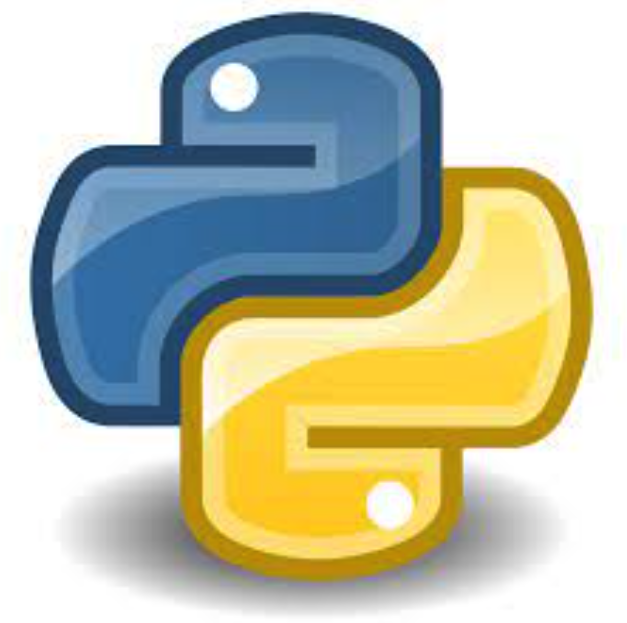
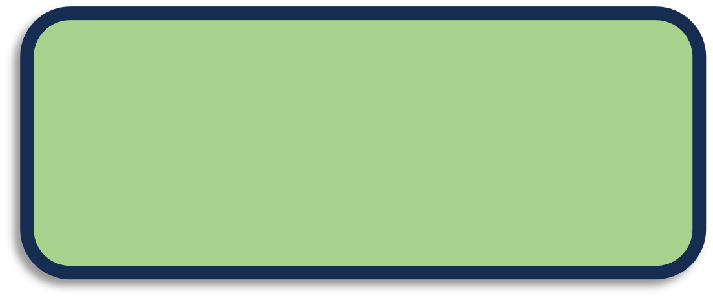
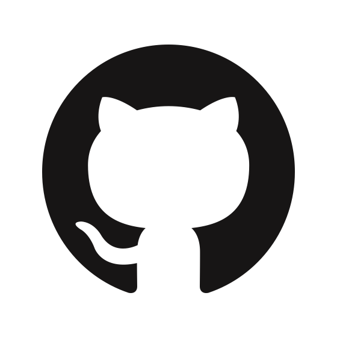
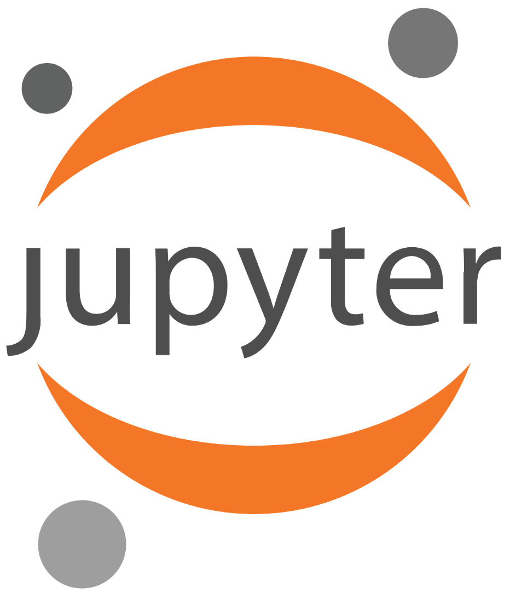
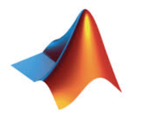

## Programming ##
* Python (110 months) {:width="25px"} {:width="40px"}{:width="40px"}{:width="40px"}{:width="40px"}{:width="40px"}{:width="40px"}{:width="40px"}{:width="40px"}
* BASH (110 months) {:width="30px"} {:width="40px"}{:width="40px"}{:width="40px"}{:width="40px"}{:width="40px"}{:width="40px"}{:width="40px"}{:width="40px"}
* scikit-learn (48 months) {:width="40px"}{:width="40px"}{:width="40px"}{:width="40px"}{:width="40px"}{:width="40px"}{:width="40px"}
* PyTorch (24 months) {:width="40px"}{:width="40px"}{:width="40px"}{:width="40px"}{:width="40px"}{:width="40px"}
* Github (86 months) {:width="30px"} {:width="40px"}{:width="40px"}{:width="40px"}{:width="40px"}{:width="40px"}
* Jupyter (86 months) {:width="25px"} {:width="40px"}{:width="40px"}{:width="40px"}{:width="40px"}
* RDKit (14 months) {:width="40px"}{:width="40px"}{:width="40px"}{:width="40px"}{:width="40px"}
* JAX / JAX-MD (14 months) {:width="40px"}{:width="40px"}{:width="40px"}{:width="40px"}
* MATLAB (12 months) {:width="35px"} {:width="40px"}{:width="40px"}{:width="40px"}{:width="40px"}
* C++ (4 months) {:width="40px"}{:width="40px"}{:width="40px"}{:width="40px"}
* Pyomo (4 months) {:width="25px"} {:width="40px"}{:width="40px"}{:width="40px"}{:width="40px"}

***Please note the green bars show a perceived degree of expertise on the skills, thus it carries a non-linear relationship with the time invested shown.***

## Simulation ##
* RASPA (24 months) {:width="40px"}{:width="40px"}{:width="40px"}{:width="40px"}{:width="40px"}{:width="40px"}{:width="40px"}{:width="40px"}
* ORCA (18 months) {:width="40px"}{:width="40px"}{:width="40px"}{:width="40px"}{:width="40px"}{:width="40px"}
* LAMMPS (6 months) {:width="40px"}{:width="40px"}{:width="40px"}{:width="40px"}
* Zeo++ (4 months) {:width="40px"}{:width="40px"}{:width="40px"}
* Gaussian (2 months) {:width="40px"}{:width="40px"}
* Quantum-Espresso (2 months) {:width="40px"}

## Research ##
* Molecular simulations (Monte Carlo and Molecular Dynamics), machine learning, graph neural networks, active learning, reinforcement learning, differentiable simulation and coarse-graining, non-linear optimization, Bayesian optimization, uncertainty quantification, statistics, adsorption thermodynamics (IAST, RAST, Wilson, Van Laar, a-NRTL), quantum chemistry and first-principles calculations, computational fluid dynamics, process engineering

## Awards ##
* Midwest Thermodynamics and Statistical Mechanics (MTSM) Conference Poster Award, 2025
* Notre Dame Graduate School Professional Development Award, US$750, 2023
* Foundations of Molecular Modeling and Simulation (FOMMS) Early Career Researcher Award by NSF, 2022
* Notre Dame Graduate School Professional Development Award, US$750, 2022
* Travel Grant, US$875, 14th Fundamentals of Adsorption (FOA 14) conference, supported by NSF and DOE, 2022
* Patrick and Jana Eilers Graduate Student Fellowship for Energy Related Research, US$8,000, ND Energy, University of Notre Dame, 2021
* Secured an All India rank of 65 in GATE (Graduate Aptitude Test in Engineering), 2013 (99.60 %tile)
* Summer Research Fellowship of the Indian Academy of Sciences at IIT Bombay, 2012
