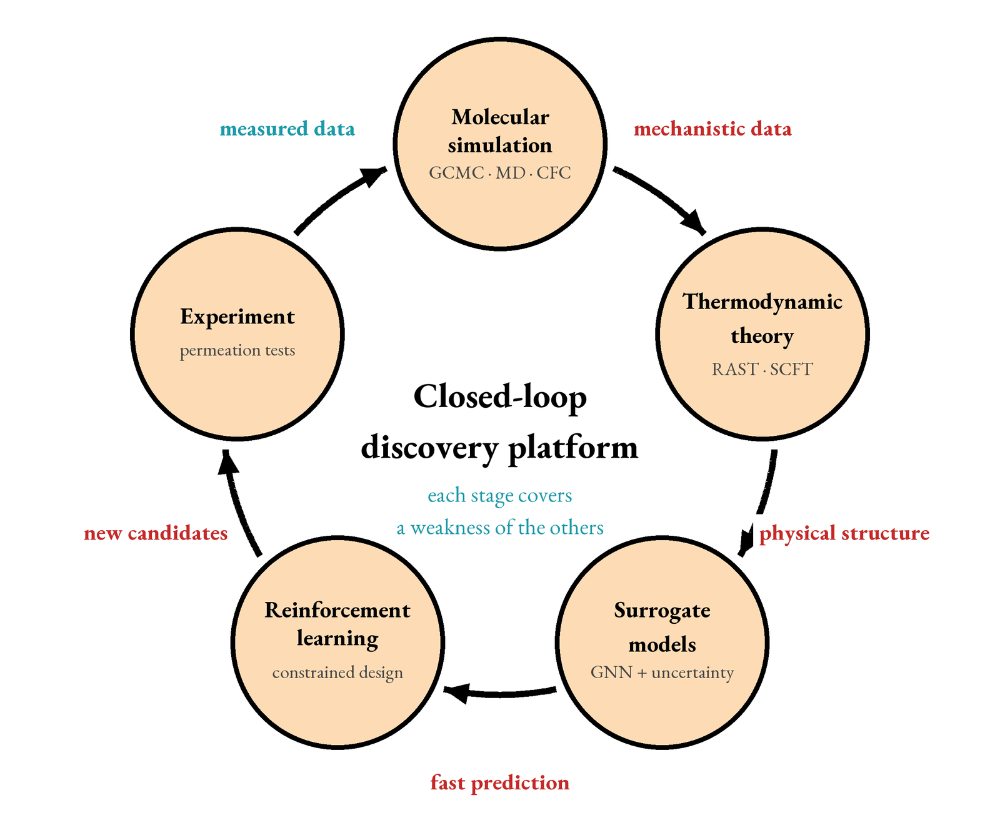
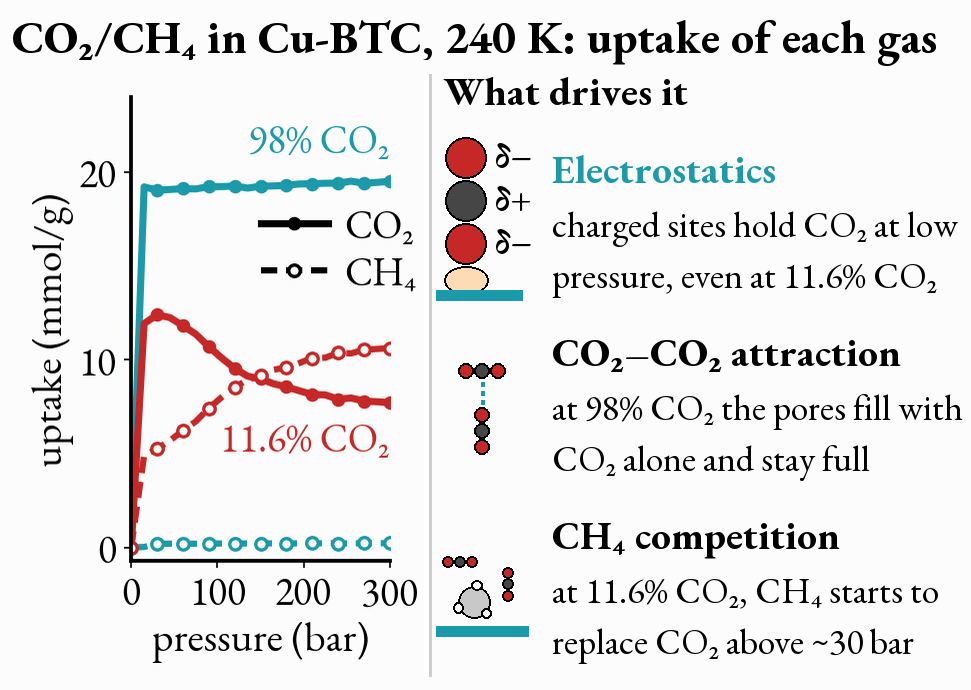
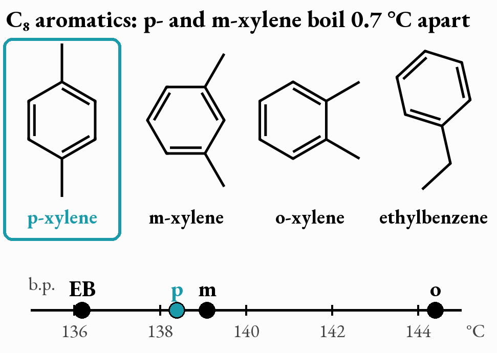
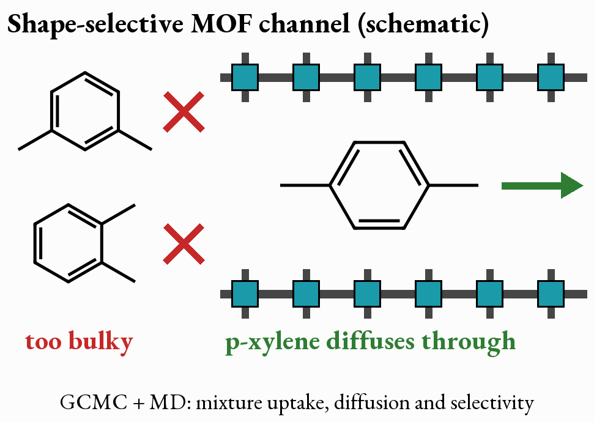
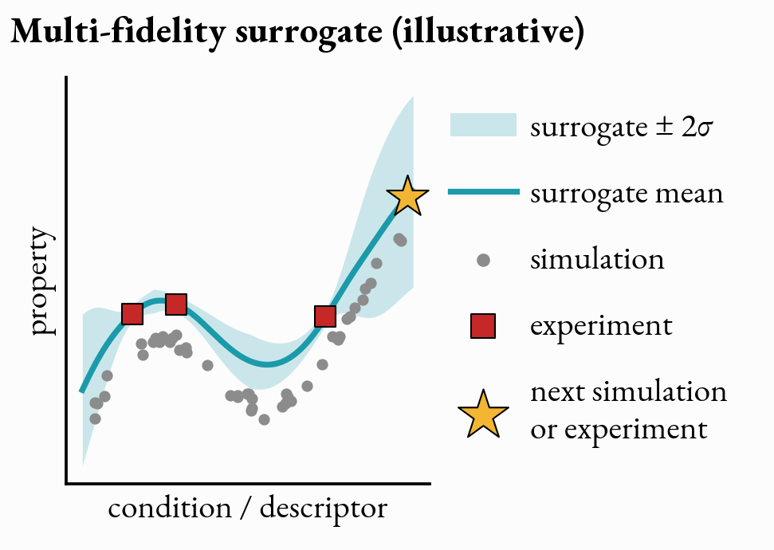
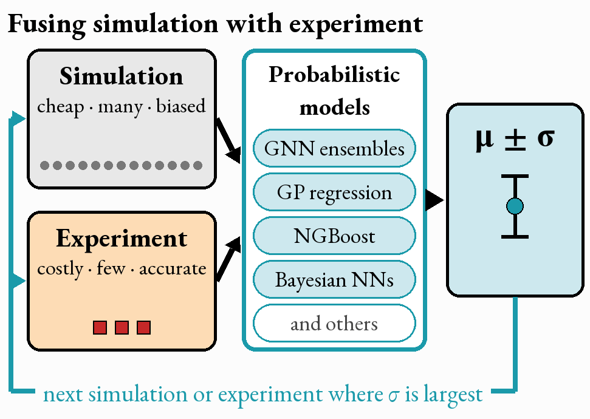
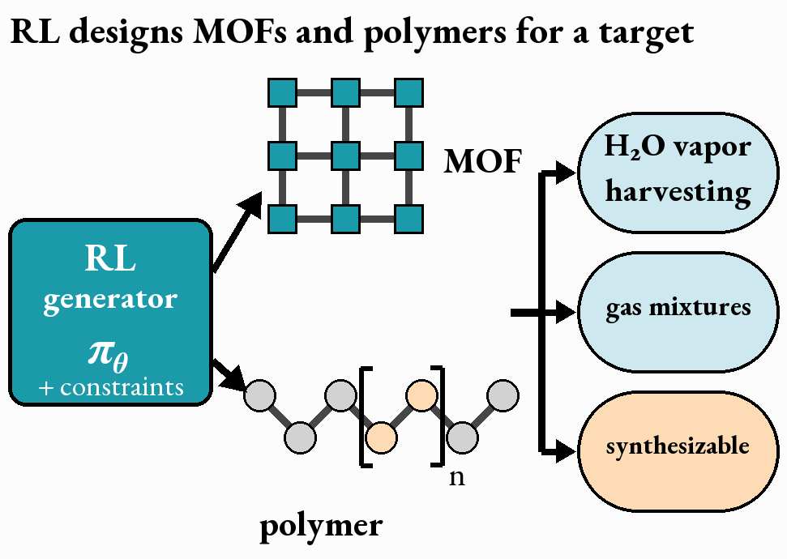
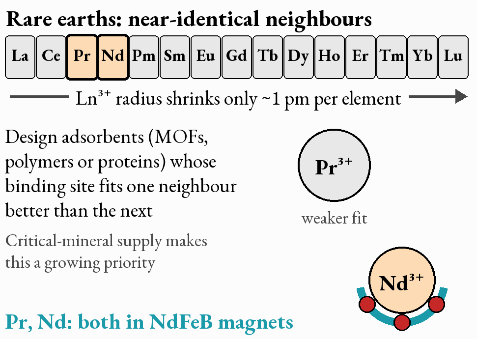

My research program is on the engineering and discovery of advanced separation materials. My long-term goal is to develop machine learning algorithms for separations that do two things: build surrogate models for structure–state–property prediction (by 'state' I am referring to the conditions a property depends on, such as temperature, pressure, and mixture composition), and design the molecular structure for a given target property (the inverse problem). Molecular simulation supplies the data these models learn from. I do care about closing the loop, so that structures proposed by the models are validated in silico or experimentally and the results feed back into the models, but developing the models and algorithms in the first place, and applying them to separation problems, comes first. The three thrusts below are my short-term plan, followed by where I see the program going in the long term (year 4 and beyond).

<figure>
  
  <figcaption>Machine learning for separations at the centre: surrogate models that map structure and state to property, and inverse design, both trained on simulation data; validation in silico or by experiment feeds back.</figcaption>
</figure>

### Molecular simulation of separation materials
* Generate adsorption, diffusion, and permeability data for mixtures across pressure, temperature, and composition (most separations of industrial interest involve mixtures, while most of the available data is for single components)
* Extend simulation protocols to chemically heterogeneous MOFs and water-containing mixtures, building on my CFC-GCMC work on water vapor adsorption
* Explore electrostatic patterning as a design handle for water vapor harvesting and separation

**Example project: CO2/CH4 competitive adsorption.** Natural-gas and biogas upgrading both come down to taking CO2 out of CH4, and how well an adsorbent does this depends on the mixture composition. When CO2 is dilute, it takes the strongest sites first: its quadrupole interacts with polar groups, open metal sites, or framework charges, while CH4, which has no dipole or quadrupole, feels almost only dispersion, so selectivity is highest here. As the CO2 mole fraction rises those strong sites fill up, the remaining CO2 goes to weaker sites where dispersion contacts with the pore walls dominate for both gases, and selectivity falls. At high loading, attraction between neighbouring CO2 molecules (quadrupole–quadrupole, favouring T-shaped pairs) partly offsets that drop. I want to map this across the full range of CO2 mole fraction with mixture GCMC, and decompose the energy into guest–host electrostatics, guest–host dispersion, and guest–guest terms, together with where each molecule sits, so that it is clear which interaction sets the selectivity at each composition.

<figure>
  
  <figcaption>CO2/CH4 competitive adsorption at 10 bar (illustrative dual-site model): selectivity is highest when CO2 is dilute and the strong sites are free, and falls as they fill. Right: the interactions that drive it.</figcaption>
</figure>

**Example project: separating the C8 aromatics.** p-Xylene (the precursor to terephthalic acid, and therefore to PET) has to be separated from o-xylene, m-xylene, and ethylbenzene, whose boiling points sit within about 8 °C of each other, with p- and m-xylene only 0.7 °C apart. Distillation therefore cannot isolate p-xylene, and the split is done today by crystallization or simulated moving-bed adsorption. I want to use mixture GCMC and molecular dynamics to screen MOFs for this separation: shape selectivity (channels that admit the slim p-xylene and keep out the bulkier o- and m-xylene) handles the xylenes, while ethylbenzene, about as slim as p-xylene, has to be separated by adsorption selectivity, which mixture GCMC captures.

<figure class="half">
  
  
  <figcaption>Left: the four C8 aromatic isomers, drawn to scale, and their boiling points; p- and m-xylene boil only 0.7 °C apart. Right: a shape-selective MOF channel (schematic).</figcaption>
</figure>

### Data-efficient, trustworthy surrogate machine learning models
* Add uncertainty quantification and calibration to GC-MPNN-type models, so that every prediction comes with an error bar
* Develop and compare probabilistic models for this: GNN ensembles, Gaussian process regression (GPR), NGBoost, Bayesian neural networks, and others
* Separate confident interpolation from unreliable extrapolation (the leave-one-gas-out results showed that a model can rank an unseen gas correctly while getting its scale wrong, and I want the model itself to flag when this happens)
* Build active-learning criteria on top of thermodynamically consistent models

**Example project: a multi-fidelity surrogate.** Simulation data is cheap and plentiful but carries systematic bias (force fields are approximate), while experimental data is accurate but scarce. I want to build a single model that learns from both ('multi-fidelity' here means exactly this: one model trained together on cheap-but-approximate and scarce-but-accurate data), built on the probabilistic models above, and that uses its own uncertainty to decide where the next experiment or simulation should be spent.

<figure class="half">
  
  
  <figcaption>Left: a multi-fidelity surrogate with its uncertainty band (illustrative data). Right: probabilistic models (GNN ensembles, GP regression, NGBoost, Bayesian NNs and others) fusing simulation with experiment, and choosing the next simulation or experiment where σ is largest.</figcaption>
</figure>

### Physics-informed inverse design
* Generate candidate MOFs and polymers with reinforcement learning, with synthesizability, stability, and physics penalties built into the reward rather than checked afterwards
* Develop differentiable coarse-graining for membrane morphology and transport

**Example projects.** Design MOFs and polymers for water vapor harvesting and for multicomponent gas mixtures. Further out, I am interested in rare-earth element separation, which is attracting growing attention because of critical-mineral supply. Neighbouring lanthanides (for example Pr and Nd, both used in NdFeB permanent magnets) differ in ionic radius by only about a picometre, so telling them apart calls for adsorbents whose binding site fits one neighbour better than the next, whether ligand-functionalized MOFs and polymers or lanthanide-binding proteins such as lanmodulin.

<figure class="half">
  
  
  <figcaption>Left: reinforcement learning designing MOFs and polymers for a target. Right: rare-earth separation, where neighbouring lanthanides are nearly identical.</figcaption>
</figure>

### Timeline
**Short term**

* Reliable surrogates: uncertainty, calibration, and transfer to new species and conditions
* Inverse design: reinforcement learning that generates MOFs and polymers for a target property, with synthesizability and stability built into the reward
* Mixture adsorption, diffusion, and permeability datasets, starting with CO2/CH4 and the C8 aromatics
* Multiscale models: differentiable coarse-graining of gas–polymer systems

**Long term (year 4 and beyond)**

* Process-level design for natural-gas sweetening, CO2 capture, H2S removal, and H2 purification
* Bio-separations and hybrid mechanistic–machine learning bioprocess models
* Datasets, models, and workflows released openly for others to build on

If any of this overlaps with what you work on, I would be glad to talk; my contact details are on the [home page](/).
